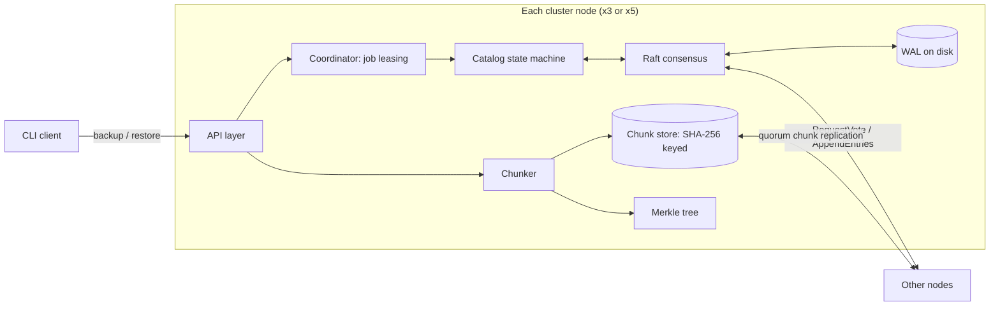

# Design Document — Distributed Backup Engine with Raft

This document explains **what** the system does, **how** it is structured,
and, most importantly, **why** each design decision was made and which
alternatives were rejected. It grows after every phase.

If you're presenting this project to someone, walk them through sections
1 → 3 first, then pick any decision from section 5 and defend it.

---

## 1. Problem statement

We want to back up large files (VM disk images, database dumps) such that:

1. **Storage is efficient.** Repeated content across files or across
   successive backups of the same file is stored only once.
2. **Data is verifiable.** On restore, we can prove every byte is what we
   originally stored.
3. **The catalog survives machine failures.** The list of "which backups
   exist and which chunks they consist of" is replicated across a cluster
   and stays consistent even when nodes crash or the network splits.

## 2. Goals and non-goals

**Goals**
- Content-defined chunking with deduplication.
- Byte-perfect restore, verified with a Merkle tree.
- Crash-consistent local catalog (write-ahead log).
- Raft consensus, written from scratch, for the replicated catalog.
- Deterministic fault-injection tests (partitions, crashes, reordering).
- A small live dashboard for observing the cluster.

**Non-goals** (deliberately out of scope)
- Encryption at rest, authentication, multi-tenant access control.
- Production-grade performance tuning.
- Geo-replication across data centers.
- Byzantine (malicious-node) fault tolerance. Raft assumes nodes may crash
  but never lie.

## 3. Architecture overview (target state)

The system has two data paths:

- **Metadata path (small, must be strongly consistent):** catalog operations
  such as "snapshot X created" go through Raft.
- **Data path (big, bulk bytes):** chunk bytes are replicated with a
  simpler quorum write, *not* through Raft. The reasoning is recorded in
  Phase 3's decisions.

## 4. Components (filled in as they are built)

| Component | Package | Phase | Status |
|---|---|---|---|
| Rolling hash | `internal/chunker/rolling.go` | 0a | done, tested |
| Chunker | `internal/chunker/chunker.go` | 0b | done, tested |
| Chunk store | `internal/store/store.go` | 0c | done, tested |
| Merkle tree | `internal/merkle` | 0 | planned |
| Write-ahead log | `internal/store` | 1 | planned |
| Simulated network | `internal/network` | 2a | planned |
| Raft | `internal/raft` | 2b–2f | planned |
| Catalog state machine | `internal/catalog` | 3 | planned |
| Job coordinator | `internal/coordinator` | 3 | planned |
| API + dashboard | `internal/api`, `web/` | 5 | planned |

## 5. Decision log

Each entry records the decision, the rejected alternative, and the reason.
Entries are added **only when the code implementing them is written**. No
entries are written ahead of time.

### Phase 0 — Chunking and local store

**D0.1 — Rolling hash: Rabin-Karp polynomial hash mod 2^64** (`internal/chunker/rolling.go`)
- *Chosen:* `H = Σ b_i · base^(w-1-i) mod 2^64`, with an odd 64-bit base,
  updated in O(1) per byte. The mod 2^64 costs nothing because `uint64`
  wraps around on overflow.
- *Rejected: true Rabin fingerprint (polynomial arithmetic over GF(2)).*
  It mixes bits better, but it needs an irreducible polynomial and
  precomputed lookup tables, and the code is much harder to reason about.
  Rabin-Karp uses the same slide formula as the hand-worked decimal
  example, so every line is easy to check.
- *Rejected for now: Gear / FastCDC.* Faster (one shift and one add per
  byte, no window buffer), but the "window" is implicit, which makes the
  concept harder to see. It's a good upgrade candidate once the chunker
  works.
- *Known weakness to handle in step 0b:* the low bits of a multiplicative
  hash are poorly mixed. The boundary test should use the high bits.
  We'll verify this by measuring the actual chunk-size distribution.

**D0.2 — Chunker is a streaming reader, not a whole-file splitter** (`internal/chunker/chunker.go`)
- *Chosen:* `New(io.Reader, Config)` plus `Next() ([]byte, error)`, which
  returns one chunk per call. Memory use is bounded by `MaxSize`, no matter
  how big the file is.
- *Rejected:* `Split([]byte) [][]byte`. It's simpler, but the whole file
  has to be in memory, and VM images are many gigabytes.

**D0.3 — Boundary rule uses the top bits: `hash >> (64 - MaskBits) == 0`**
- *Chosen:* test the high bits, because every byte in the window affects
  them (see D0.1).
- *Rejected:* the common `hash & mask == 0`, which tests the low bits and
  would inherit the weak low-bit mixing of a multiplicative hash.

**D0.4 — Chunk sizes: min 2 KiB, mask 13 bits, max 64 KiB, window 48 B**
- The expected size is `MinSize + 2^13` ≈ 10 KiB, because no boundary is
  checked before `MinSize`. The measured size matches (see section 7).
- *Smaller (e.g. avg 1 KiB) rejected:* about 10× more chunk hashes to store
  and replicate per GB, and each 32-byte SHA-256 hash is catalog metadata.
- *Larger (e.g. avg 64 KiB) rejected:* one small edit invalidates a much
  larger region, so deduplication gets worse.
- For comparison, the LBFS paper used an 8 KiB average. Modern tools like
  restic and borg use about 1–2 MiB, trading deduplication granularity
  for much less metadata at terabyte scale. Our 10 KiB suits small
  experiments and makes dedup effects easy to see. This is a starting
  point, to be re-tuned on real data in step 0e.

**Observation — runs of zero bytes always cut at `MinSize`.** A window of
48 zero bytes hashes to exactly 0, which passes the boundary test. Sparse
regions (common in VM images) therefore split into many 2 KiB chunks.
They are all identical, so they deduplicate to one stored chunk, but each
still costs one catalog entry. We accept this for now and will revisit it
once step 0e measures real data.

**D0.5 — Chunks are named by SHA-256** (`internal/store/store.go`)
- *Chosen:* SHA-256, which is in the standard library and
  hardware-accelerated. It's collision-resistant, so a name maps to exactly
  one content.
- *Rejected: CRC32.* With 2^32 names, the birthday bound gives about a 50%
  chance of a collision after roughly 77,000 chunks (≈ 750 MB at 10 KiB per
  chunk). A collision would make `Put` skip a genuinely new chunk, and
  restore would silently return the wrong bytes. CRC32 is also linear, so
  collisions can be forged on purpose.
- *Rejected for now: BLAKE3.* It's faster, but it's a third-party dependency
  and we haven't measured hashing as a bottleneck.

**D0.6 — One file per chunk, with a two-hex-character fan-out directory**
- *Chosen:* `chunks/2c/2cf24d…`, which gives 256 buckets (the same scheme Git
  uses for its objects). It's trivial to inspect, and dedup is one
  `os.Stat` call.
- *Rejected for now: pack files* (many chunks appended into one file, plus
  an offset index). Less per-file overhead, but the index needs its own
  crash consistency, which is the Phase 1 problem.

**Known risk R0.1 — chunk writes are not atomic (deferred to Phase 1).**
`Put` calls `os.WriteFile` directly. If the process crashes mid-write,
a *partial* file exists under the correct name. `Get` detects this (the hash
won't match, so it returns `ErrCorrupt`), but `Put` only checks that the file
*exists*, so it will never repair it. Fix candidate: write to a temp file,
`fsync`, then `rename` it into place (rename is atomic on POSIX). This was
left out on purpose so it can be explained properly in Phase 1.

**Known limitation — `Store` isn't safe for concurrent use.** Two goroutines
putting the same new chunk could interleave their writes. That's fine while
only one goroutine writes. We'll revisit it when the data path becomes
concurrent in Phase 3.

## 6. Guarantees (stated precisely, filled in once tested)

| Guarantee | Status |
|---|---|
| Restore is byte-identical to the original | not yet tested |
| Acknowledged catalog writes survive a crash | not yet tested |
| At most one leader per Raft term | not yet tested |

## 7. Measured results

Only numbers printed by a reproducible test run go here. These are
**synthetic-data** results. Real-dataset dedup numbers come in step 0e.

| What | Result | Reproduce with |
|---|---|---|
| Chunk sizes, 8 MiB random data (seed 2) | 847 chunks, avg 9903 B, min 2051 B, max 57531 B | `go test -v -run TestRoundTrip ./internal/chunker/` |
| One-byte insert at start, 1 MiB random data (seed 3) | 99 of 100 chunks unchanged | `go test -v -run TestInsertAtStart ./internal/chunker/` |
| 200 KiB of zero bytes | 100 chunks, each 2048 B (MinSize) | `go test -v -run TestIdentical ./internal/chunker/` |

## 8. Bugs found by testing

A log of real bugs that the tests caught, and what they taught us.
